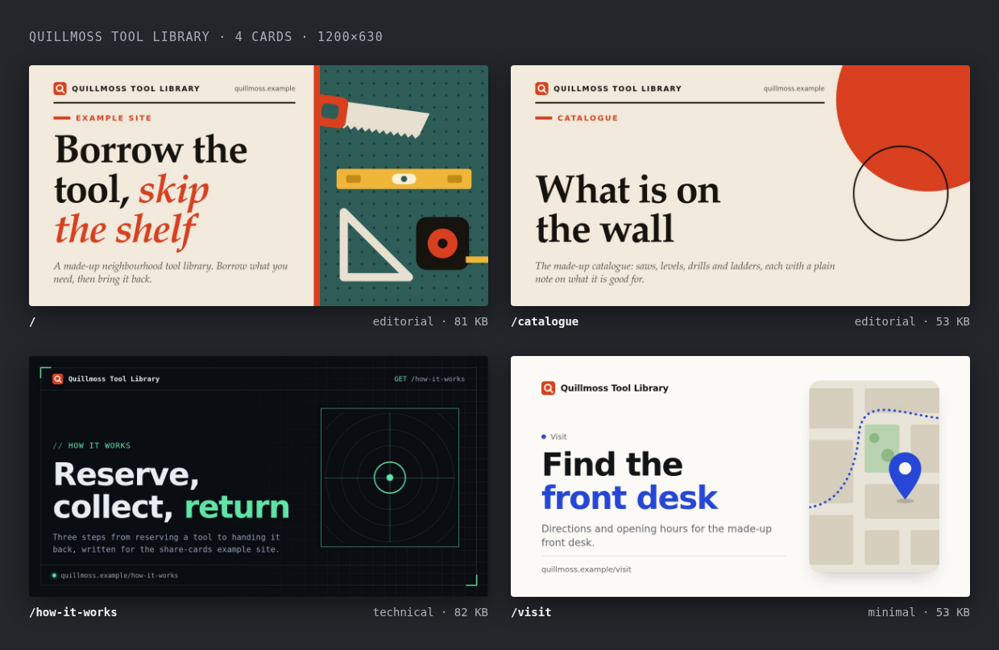

# share-cards

Link-preview images and per-page share tags for every page of a website, from one HTML template.



When someone pastes a link into a chat app or a social site, that app fetches the page and reads a few tags in its `<head>`: the title, the description and the address of a preview image. These crawlers **do not run JavaScript**. A single-page app sends the same HTML for every address, so every link shows the same title and the same picture, or none.

share-cards does two things at build time:

- **Draws a 1200×630 card for every page** from one HTML/CSS template, using a headless browser.
- **Writes one HTML file per page** from your built `index.html`, each with its own `<title>`, description, canonical address, `og:*` and `twitter:*` tags.

It is packaged as a [Claude Code](https://claude.com/claude-code) skill (`SKILL.md` tells the assistant how to use it) and works the same by hand from the command line.

## How it works

| Stage | What happens | Sample |
|---|---|---|
| 1. List | You list each page once in `cards.config.json`. | `{ "path": "/visit", "title": "Visit \| Quillmoss Tool Library", "cardTitle": "Find the *front desk*" }` |
| 2. Render | A headless browser fills the template and saves a JPEG per page. Unchanged cards are skipped by content hash (config text, template, the local files its `src` and `href` point at, art, logo, fonts). Files reached only from inside CSS are not tracked: use `--force` after changing one. | `drew /visit -> dist/og/visit.jpg (53 KB)` |
| 3. Inject | The built page shell is copied once per page with that page's tags filled in. | `<meta property="og:image" content="https://quillmoss.example/og/visit.jpg" />` |
| 4. Verify | Sizes, weights, lengths, escaping and addresses are checked before you deploy. | `4 pages checked, cards total 268 KB, built pages checked` |

## Requirements

| Needed | Why | Licence |
|---|---|---|
| Node.js 18 or newer | runs everything | MIT |
| [playwright-core](https://www.npmjs.com/package/playwright-core) | drives the browser (`render` and `preview` only) | Apache-2.0 |
| Google Chrome, Chromium, Microsoft Edge or Playwright's own Chromium | draws the cards | their own licences |

None of these is included in this repository. `inject`, `verify`, `rewrites` and `tags` need only Node.

No fonts are bundled. The built-in templates use system font stacks, and nothing is fetched from a network while rendering unless you opt in (see [Fonts](#fonts)).

## Install

```bash
git clone https://github.com/VinVirtual/share-cards ~/.claude/skills/share-cards
npm i -g playwright-core          # or: npm i -D playwright-core in your project
~/.claude/skills/share-cards/cards check
```

`cards check` reports which copy of playwright-core and which browsers it found, and starts one to prove it works. Two environment variables override the search: `CARDS_PLAYWRIGHT` (path to playwright-core) and `CARDS_CHROME` (path to a Chromium-based browser). If no browser starts and `TMPDIR` points at a very long path, shorten it: Chrome keeps sockets there and their paths have a length limit.

The commands below are written as `cards`; use the full path, an alias, or `npm i -D /path/to/share-cards` and `npx cards`. `cards` is a small bash launcher; where bash is missing, run `node lib/cli.mjs` instead.

## Quick start

```bash
cd my-site
cards init                 # writes cards.config.json; edit the pages
cards render               # draws public/og/*.jpg
cards preview              # cards-preview/contact-sheet.png and chat-preview.html: look at them
cards tags                 # prints the <head> tags; paste them into your source index.html
npm run build              # your normal build
cards inject               # writes dist/<page>/index.html for every page
cards verify               # must end with "All good."
```

## Commands

| Command | What it does |
|---|---|
| `cards check` | Is Node, playwright-core and a browser ready? |
| `cards init [dir] [--mjs]` | Write a starter `cards.config.json` (or `cards.config.mjs`). |
| `cards render [dir]` | Draw every card that changed. `--force` redraws all, `--only /path` limits it (repeatable), `--jobs 3` sets how many pages are open at once. |
| `cards inject [dir]` | Read `<dist>/index.html` and write one HTML file per page. `--dist d`, `--html file` (a different shell), `--out d` (write elsewhere), `--add-missing`. |
| `cards verify [dir]` | Check cards, text and built pages. `--no-html` skips built pages, `--require-html` fails if there are none. |
| `cards preview [dir]` | Write `cards-preview/contact-sheet.png`, `chat-preview.html` and `chat-preview.png`. |
| `cards build [dir]` | `render`, then `inject`, then `verify`. |
| `cards rewrites <vercel\|netlify\|netlify-toml> [dir]` | Print host rules. `--spa` adds a catch-all to `/index.html` at the end. |
| `cards tags [dir]` | Print the `<head>` tags a page shell needs. |
| `cards eject <template> [file]` | Copy a built-in template to edit. |
| `cards test` | Run the unit tests. |

`[dir]` is the folder that holds the config (default: the current folder), or the config file itself. Paths inside the config are relative to that folder.

## Config

```json
{
  "siteUrl": "https://example.com",
  "siteName": "Example Site",
  "template": "editorial",
  "logo": "public/logo.svg",
  "theme": { "accent": "#d8401f" },
  "imageDir": "public/og",
  "imageUrlPath": "/og",
  "dist": "dist",
  "pages": [
    {
      "path": "/pricing",
      "title": "Pricing | Example Site",
      "description": "One sentence, 160 characters at most.",
      "cardTitle": "Simple *pricing*",
      "kicker": "Plans",
      "art": "public/img/pricing.jpg",
      "template": "minimal"
    }
  ]
}
```

| Setting | Default | Meaning |
|---|---|---|
| `siteUrl` | required | The production origin. Preview images need absolute addresses, so this must be the real `https://` address. |
| `siteName` | required | Shown on cards and written to `og:site_name`. |
| `template` | `editorial` | `editorial`, `minimal`, `technical`, or a path to your own `.html` file. |
| `logo` | none | An image drawn on every card. |
| `theme` | `{}` | CSS variables for the template: `accent`, `background`, `text`, `muted`, `fontDisplay` and others. See [references/templates.md](references/templates.md). |
| `fonts` | `[]` | Local font files to load: `{ "family", "file", "weight", "style" }`. |
| `imageDir` | `public/og` | Where the JPEGs are written. Use a folder your build copies into the site. |
| `imageUrlPath` | `/og` | The address that folder is served at. |
| `dist` | `dist` | The built site that `inject` and `verify` read. |
| `width`, `height` | `1200`, `630` | Card size in pixels. The built-in templates are designed for the default. |
| `quality` | `88` | JPEG quality, 1 to 100. |
| `maxImageKB` | `300` | `verify` fails a card heavier than this. |
| `versionImages` | `false` | Add `?v=<hash>` to image addresses so apps that cache previews fetch a changed card. |
| `allowNetwork` | `false` | Let templates load files from the network while rendering. |

Each page:

| Setting | Meaning |
|---|---|
| `path` | Required. The address without the origin: `/`, `/pricing`, `/guides/first-loan`. |
| `title` | Required. Goes into `<title>`, `og:title` and `twitter:title`. |
| `description` | Required. Goes into the description tags. `verify` fails over 160 characters. |
| `cardTitle` | The words drawn on the card (default: `title`). `*Stars*` mark words drawn in the accent colour. |
| `cardDescription` | The line drawn under it (default: `description`). |
| `kicker` | A small label above the title. |
| `art` | An image file drawn on the card. |
| `template` | A different template for this page. |
| `image` | The image file name without `.jpg` (default: from the path, `/guides/first-loan` → `guides-first-loan`, `/` → `home`). |

A `cards.config.mjs` may `export default` the same object, or a function that returns it, so the page list can be built from your own routes or content files:

```js
import { posts } from './src/content/posts.js'

export default {
  siteUrl: 'https://example.com',
  siteName: 'Example Site',
  pages: [
    { path: '/', title: 'Example Site', description: 'What the site is, in one sentence.' },
    ...posts.map((post) => ({ path: `/posts/${post.slug}`, title: `${post.title} | Example Site`, cardTitle: post.title, description: post.summary, kicker: 'Post' })),
  ],
}
```

## Templates

Three built-in templates, each a different layout and type treatment:

- **editorial**: warm paper, a masthead rule and a heavy serif headline. Art fills the right edge; without art there is an accent disc and an ink ring.
- **minimal**: near-white, one weight of sans, a single accent dot. Art sits in a tall rounded frame.
- **technical**: near-black with a drafting grid, monospace labels and corner marks. Art sits in a square framed panel; without art there is a drawn scope.

Templates are plain HTML and CSS. Elements marked `data-slot="title"` (and `kicker`, `description`, `site`, `domain`, `path`, `address`, `logo`, `art`) are filled in, and `theme` values become CSS variables. Titles shrink to fit; one that cannot fit even at the smallest size is cut at a word with an ellipsis and `render` warns you. A description that does not fit also produces a warning.

[references/templates.md](references/templates.md) lists every slot and variable and explains how to write your own.

### Fonts

- By default the templates use system font stacks. Nothing is bundled and nothing is downloaded. Cards drawn on a different machine can therefore use different fonts.
- For the same result everywhere, add font files to your project and list them under `fonts`. Check the licence of any font you commit; the SIL Open Font License and Apache-2.0 both allow it when the notice travels with the files.
- Network requests are blocked while rendering and reported as warnings. `"allowNetwork": true` turns that off.

## Look before you ship

`cards preview` writes:

- `cards-preview/contact-sheet.png`: every card with its page, template and file size.
- `cards-preview/chat-preview.html` (and a `.png` of it): each page as a link pasted into a made-up chat thread, light and dark, with the title and description cut the way previews usually cut them.

It is an imitation. Real apps crop, trim and cache in their own ways.

## What `verify` checks

- Every page has a card, it is a JPEG of exactly `width`×`height`, and it weighs no more than `maxImageKB`.
- Every card matches the current config and template (a stale card fails; run `cards render`).
- Descriptions are 160 characters or fewer. Titles over 70 characters get a warning.
- Image addresses are absolute `https://` addresses.
- In the built site, every page has its own HTML file, and its title, description, canonical, `og:*` and `twitter:*` values read back exactly as written in the config. An unescaped quote, which would cut a value short, fails this check.
- A warning if the card files are not inside the built site.

## Framework notes

### Vite

```js
// vite.config.js
import shareCards from 'share-cards/vite'   // or a relative path to vite-plugin.mjs

export default {
  plugins: [shareCards()],                  // options: { config: '.', addMissing: false }
}
```

The plugin runs after a successful `vite build`, reads `cards.config.json` from the Vite root and writes the per-page files into Vite's `build.outDir`. It does not draw cards: run `cards render` before the build with `imageDir` set to a folder inside `public/`, and commit the JPEGs and `cards.lock.json`. CI then needs no browser.

### Plain static sites and other build tools

Run `cards inject` after your build:

```json
{ "scripts": { "build": "your-build-command && cards inject" } }
```

`inject` needs one built HTML file to copy (`<dist>/index.html`, or `--html`). If your generator already writes a separate HTML file per page, it can write these tags itself; you can still use `render` for the images and `verify --no-html` for the checks, or import `withPageMeta` from `lib/index.mjs` to fill tags in your own script.

The page shell must already contain the tags to fill. `cards tags` prints them. `inject` stops with a list of the missing tags rather than writing a page that previews badly; `--add-missing` adds them before `</head>` instead.

### Host rewrites

After `inject`, `/visit` exists as `visit/index.html`. Many static hosts serve that on their own. You need explicit rules when a catch-all rewrite sends every address to `/index.html`, which is the usual single-page-app setup, and on some hosts would win over the page files. Put the page rules **before** the catch-all.

```bash
cards rewrites vercel          # a "rewrites" list for vercel.json
cards rewrites netlify         # lines for a _redirects file
cards rewrites netlify-toml    # [[redirects]] blocks for netlify.toml
```

```json
{
  "rewrites": [
    { "source": "/visit", "destination": "/visit/index.html" }
  ]
}
```

```
/visit  /visit/index.html  200
```

Add `--spa` to append the catch-all (`/(.*)` → `/index.html` for Vercel, `/*  /index.html  200` for Netlify) after the page rules. The helper only prints; you paste the result into your host config.

## Example

[`examples/site`](examples/site) is a four-page single-page app for a made-up tool library:

```
examples/site/
  cards.config.json        the four pages, three templates
  art/                     logo and two drawings (SVG)
  cards.lock.json          content hashes of the rendered cards
  dist/                    the "built" site
    index.html             the page shell, with the home page's tags
    app.js, style.css      the app; it picks the page from the address
    og/*.jpg               the four cards
    catalogue/index.html   written by `cards inject`
    how-it-works/index.html
    visit/index.html
  cards-preview/           contact sheet and chat preview
```

To rebuild it: `cards build examples/site && cards preview examples/site`. To see the site, serve `examples/site/dist` with any static server. The address `quillmoss.example` is not a real site, so its links cannot be tested in a real app.

## Tests

```bash
cards test
```

69 unit tests run with `node --test` and need no browser: tag injection, escaping, missing-tag failures, incremental hashing, config validation, rewrite rules, image-size reading, the verify checks, browser launch retries (with a fake browser) and the Vite plugin hooks. One test checks that the committed example pages are exactly what `inject` produces.

## Limits and what has not been tested

- **Real crawlers were not tested.** The tags follow the Open Graph and Twitter card conventions, and the example pages were fetched without JavaScript to confirm the tags are in the HTML. No link was pasted into a real chat app or social site, because the example address is not a real site.
- **Host rewrites were not tested on a deployed site.** The printed rules follow each host's config format as understood when this was written. They were not checked against a live deploy, so check the first one.
- **Tested on Linux with Google Chrome and Node 24**, and the Vite plugin with Vite 6. macOS and Windows are handled in the code (browser paths, path separators) but have not been run. Node 18 to 22 have not been run.
- **Fonts differ between machines** unless you supply font files, so a card drawn on a laptop and in CI can differ. Render in one place and commit the result.
- **Layout is automatic within limits.** A very long title is cut with an ellipsis and a warning. Read the contact sheet.
- **JPEG only**, one size per page. No per-network variants (square or tall).
- **Previews are cached** by the apps that show them, sometimes for days. `versionImages` changes the image address when a card changes; the app decides when to fetch the page again.
- The HTML is edited with pattern matching, not a full parser. It expects ordinary `<meta>`, `<link>` and `<title>` tags in the head; a share tag inside an HTML comment would also be filled.

## Licence

MIT, see [LICENSE](LICENSE). The example drawings in `examples/site/art` were made for this repository and are under the same licence.
